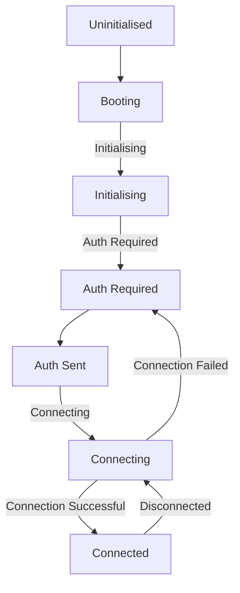
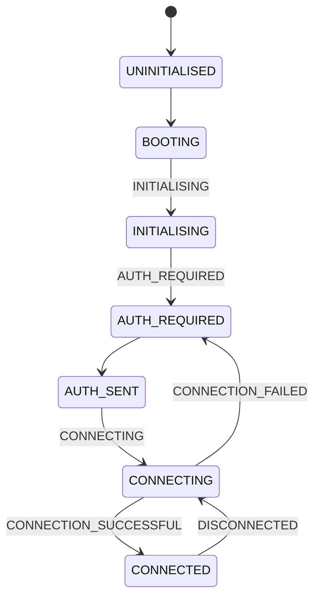
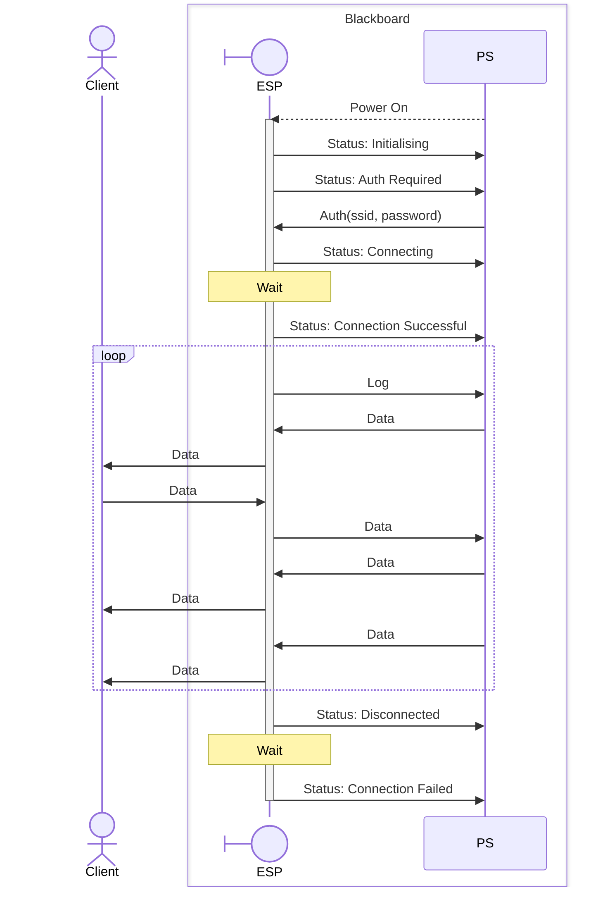

# BWifi

This driver manages communication with the Wi-Fi module onboard the Blackboard.

## Setup

The ESP32 chip on the board must be flashed with the correct firmware.

TODO: Add instructions for flashing the firmware.

## Example

```c
#include <xstatus.h>

#include "bwifi.h"

#include "xil_printf.h"

// Handle incoming data from the Wi-Fi module
void data_handler(const char* data, u32 len) {
  print("Data: ");
  for (int i = 0; i < len; i++) {
    outbyte(data[i]);
  }
  print("\r\n");
}

// Handle status changes from the Wi-Fi module
void status_handler(bwifi_status_t status) {
  switch (status) {
    case BWIFI_STATUS_CONNECTING:
      print("\r\nConnecting...\r\n");
      break;
    case BWIFI_STATUS_CONNECTION_SUCCESSFUL:
      print("\r\nConnected to Wi-Fi.\r\n");
      // Once connected the IP address is available, it is a u32
      u32 addr = BWifi_GetAddress();
      xil_printf(
        "Address: %d.%d.%d.%d.\r\n", (u8)(addr >> 24), (u8)(addr >> 16), (u8)(addr >> 8), (u8)(addr)
      );
      break;
    case BWIFI_STATUS_CONNECTION_FAILED:
      print("\r\nFailed to connect to Wi-Fi.\r\n");
      break;
    case BWIFI_STATUS_DISCONNECTED:
      print("\r\nDisconnected from Wi-Fi.\r\n");
      break;
    case BWIFI_STATUS_AUTH_REQUIRED:
      // The Wi-Fi module signals that it needs the credentials.
      if (
        BWifi_Connect(
          "Test Hotspot",
          "TerriblePassword"
        ) != XST_SUCCESS
      ) {
        print("\r\nFailed to send credentials.\r\n");
      } else {
        print("\r\nCredentials sent.\r\n");
      }
      break;
    default:
      break;
  }
}

int main() {
  print("\r\nApplication Started\r\n");

  if (BWifi_Initialize() != XST_SUCCESS) {
    print("\r\nFailed to initialize Wi-Fi\r\n");
    return XST_FAILURE;
  }

  BWifi_SetHandler(data_handler);
  BWifi_SetStatusHandler(status_handler);

  // Wait for the Wi-Fi module to connect
  BWifi_WaitConnected();

  // It is always polite to send a greeting
  BWifi_Send("Hello from the Blackboard!\r\n");

  int count = 0;
  while (1) {
    BWifi_Sendf("Count: %d\r\n", count);
    count++;
    sleep(1);

    // To maintain the connection, you must call BWifi_Loop() periodically
    BWifi_Loop();
  }

  return XST_SUCCESS;
}
```

## BWiFi Protocol

```
BaudRate = 115200
DataBits = 8
Parity   = None
StopBits = 1
```

Each packet is encoded with COBS, null-terminated.

> In hindsight, it would have been better to only COBS encode parts of the packet that
> require it. There is no need to encode the packet type for example.
>
> In addition, using proto buffers may have been a better choice for the packet format.

`FF FF FF FF` will be emitted after the program
enters, in case there is a loud bootloader logging on
the UART that we are using (which there is).

### Packet Types

```
+----------+-----------+
| Type (1) | Data (\*) |
+----------+-----------+
```

Type:

 0. Version
 1. Status
 2. Auth
 3. Log
 4. Data
 5. Address
 6. Time

#### Packet Type - Version

```
+-----+-------------+
| 0x0 | Version (2) |
+-----+-------------+
```

This packet will be sent once the WiFi module is booted, to ensure that the firmware on the module matches the drivers.

#### Packet Type - Status

```
+-----+------------+
| 0x1 | Status (1) |
+-----+------------+
```

Status:

 1. Initialising
 2. Auth Required
 3. Connecting
 4. Connection Failed
 5. Connection Successful
 6. Disconnected

 This packet will be used to send events that relate to the state of the WiFi module.





#### Packet Type - Auth

```
+-----+----------+----------------+
| 0x2 | SSID (\*) | Password (\*) |
+-----+----------+----------------+
```

#### Packet Type - Log

```
+-----+-----------+--------------+
| 0x3 | Level (1) | Message (\*) |
+-----+-----------+--------------+
```

Level:

 1. Info
 2. Warning
 3. Error

#### Packet Type - Data

```
+-----+-----------+
| 0x4 | Data (\*) |
+-----+-----------+
```

This packet will contain data that is forwarded.



#### Packet Type - Address

```
+-----+-------------+
| 0x5 | Address (4) |
+-----+-------------+
```

This packet will contain the (IPv4) address of the client as 4 bytes.

#### Packet Type - Time

```
+-----+-----------+
| 0x7 | Time (8)  |
+-----+-----------+
```

This packet will contain the current time from the wifi module (in milliseconds since epoch).
